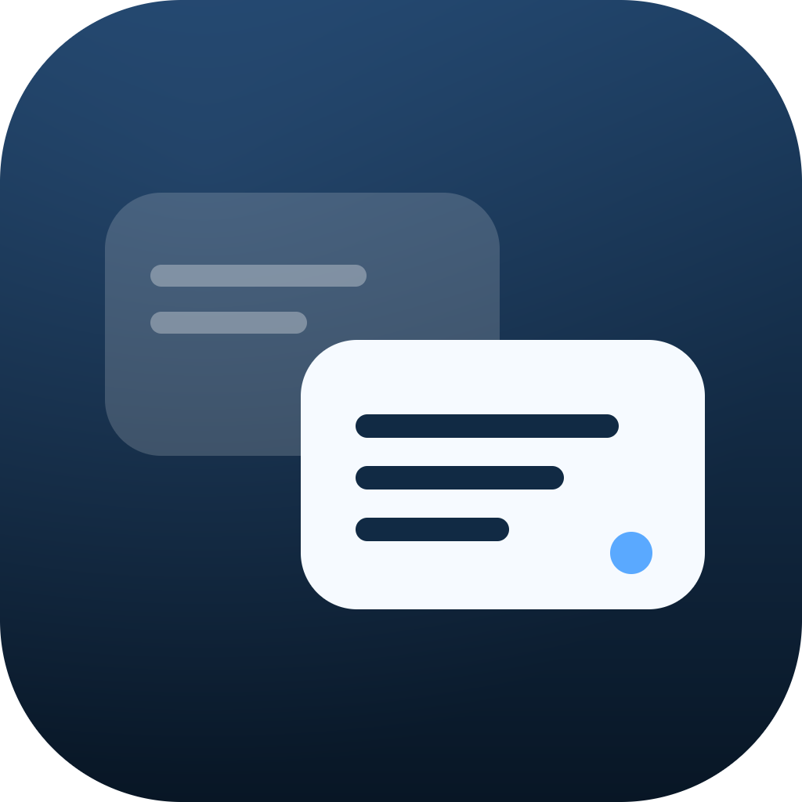

# Amigo

A native desktop translation client in pure Rust: DeepL over its hosted MCP
service, plus local or cloud Ollama models. Run either provider or both and
compare their output side by side. The UI is GPUI (Zed's GPU renderer); there
is no WebView and no local web server.



## Features

- **DeepL** via OAuth 2.1 + PKCE and the MCP `translate-text` tool — sign in
  from the app, no API key
- **Ollama** against the local daemon, with TranslateGemma 4B/12B/27B, Gemma 4
  and DeepSeek V4.1 Flash (cloud) as models
- Any number of provider slots, each with its own pair, model, mode and
  sampling; saved as presets you can switch between
- **Multi-sample mode**: several translations of one sentence, shown as
  word-level diffs against the most typical sample, with duplicate samples
  grouped
- Register and free-text context hints appended to Ollama prompts
- Portuguese (PT/PT-PT/PT-BR/PT-AO) and Spanish (ES/AR/CO/MX) pairs alongside
  English
- Copy per result, character limit, stale-result marker, error banner,
  `Cmd+Enter` to translate and `Cmd+,` for settings

## Run it

Needs a recent stable Rust toolchain, plus `ollama serve` if you use the local
provider.

```sh
cargo run -p amigo
```

DeepL signs in from the Settings window and opens a browser; Ollama needs only
the daemon and a pulled model:

```sh
ollama pull translategemma:4b
```

## Build the macOS app

```sh
./scripts/bundle-macos.sh     # builds dist/Amigo.app
./scripts/run-macos.sh        # builds it and opens it
```

The bundle script compiles the release binary, generates `AppIcon.icns` in pure
Python, writes `Info.plist`, and ad-hoc signs the result.

## Where state lives

| Path | Contents |
|---|---|
| `~/Library/Application Support/Amigo/preferences.json` | providers, presets, options |
| `~/Library/Application Support/Amigo/mcp-session.json` | DeepL OAuth session (0600) |
| `~/Library/Application Support/Amigo/mcp-client.json` | DeepL client registration (0600) |
| `~/Library/Logs/Amigo/amigo.log` | log, rotated once at 1 MB |

Settings → **Copy diagnostics** grabs the app version, sign-in state, provider
configuration and the last 500 log lines.

## Project layout

```text
apps/amigo            GPUI application: AppState model, views, theme
crates/deepl-engine   worker thread: provider jobs, OAuth lifecycle, validation
crates/deepl-core     UI-agnostic: MCP client, OAuth, Ollama, pairs, config, diff
scripts/              icons and the macOS bundle
```

## How it fits together

The engine runs on its own thread and reports over an async channel; the UI
awaits those events, so nothing polls and the UI thread never waits on the
network or on the browser sign-in.

`AppState` (`apps/amigo/src/app/state.rs`) owns the engine, preferences, session
and results, and implements no rendering at all. Views hold it, read it while
rendering, and call commands on it to change anything. GPUI repaints a view when
an entity it read notifies, so every open window stays in sync without
observers; the one subscription is the main view reacting to the state events
that ask for a window to open (sign-in, provider setup).

## Tests

```sh
cargo test --workspace
```

Covers config persistence and preset operations, the word-level diff, language
pair mapping and swap rules, PKCE and OAuth callback parsing, MCP JSON-RPC
handling, and Ollama prompt construction.
